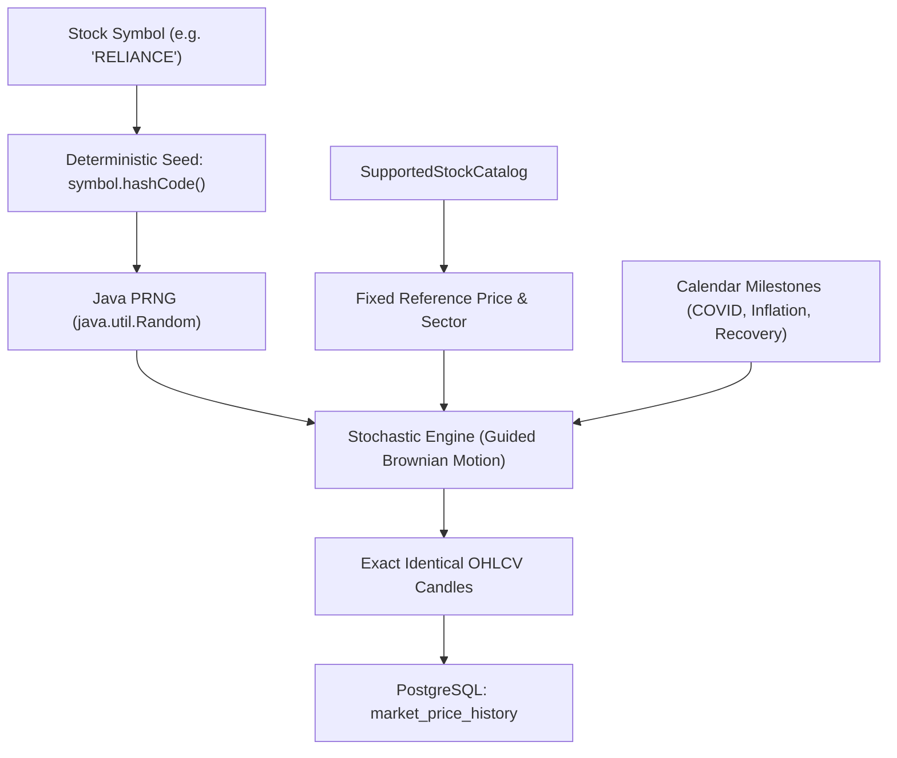

# TradeX Historical Market Data Determinism & Multi-Server Architecture

This guide explains how TradeX generates **identical, reproducible historical market datapoints (OHLCV candles)** when running or building across multiple different servers, environments, and operating systems (local development, staging, Docker containers, and cloud production VMs).

---

## 1. Problem Statement

In simulated fintech and paper-trading applications, generating historical charts typically introduces two major problems:
1. **Third-Party Dependency**: Relying on external market APIs (e.g., Yahoo Finance, Alpha Vantage) incurs strict rate limits, recurring costs, and breaks offline development.
2. **Multi-Server Inconsistency**: If an internal engine generates synthetic charts using unseeded random numbers (`new Random()` or `Math.random()`), each server instance produces a completely different chart. A user looking at `RELIANCE` on a local machine would see completely different historical highs, lows, and candle shapes than on a staging or production server.

TradeX solves this by employing **deterministic mathematical modeling**. Any server running TradeX—regardless of hardware architecture or operating system—will independently synthesize the exact same historical candlestick charts without needing an external market data feed or live network synchronization.

---

## 2. Core Pillars of Determinism



### Pillar 1: Deterministic Pseudo-Random Seeding (PRNG)

In [`HistoricalMarketDataSeeder.java`](file:///home/shubham/Dev/java_projects/trade-x/trade-x-api/market-service/src/main/java/in/shubhamprakash681/market_service/service/HistoricalMarketDataSeeder.java#L274):

```java
Random random = new Random(stock.symbol().hashCode());
```

1. **JLS Specification Guarantee**:  
   The Java Language Specification (JLS §3.10.5) strictly dictates the hash code algorithm for `java.lang.String`:
   $$\text{hashCode}(s) = \sum_{i=0}^{n-1} s[i] \cdot 31^{n-1-i}$$
   Because this formula uses standard 32-bit two's complement integer arithmetic, `"RELIANCE".hashCode()` always evaluates to the exact same integer on **every CPU architecture** (x86_64, ARM64/Apple Silicon, RISC-V) and **every operating system** (Ubuntu Linux, Alpine, macOS, Windows).

2. **Linear Congruential Generator (LCG)**:  
   Java’s `java.util.Random` uses Donald Knuth's 48-bit Linear Congruential Formula ($X_{n+1} = (aX_n + c) \pmod m$). Given the same initial seed, the sequence of `random.nextGaussian()` and `random.nextDouble()` calls is **100% deterministic**.

---

### Pillar 2: Fixed Reference Anchors & Floating-Point Precision

In [`SupportedStockCatalog.java`](file:///home/shubham/Dev/java_projects/trade-x/trade-x-api/market-service/src/main/java/in/shubhamprakash681/market_service/catalog/SupportedStockCatalog.java):
* All supported equities and ETFs have immutable reference prices (e.g., `RELIANCE = 2940.10`, `TCS = 3890.70`, `INFY = 1525.35`).
* Starting prices at the beginning of the historical window are calculated using fixed interval ratios:
  ```java
  BigDecimal startRatio = switch (targetInterval) {
      case SECONDS -> new BigDecimal("0.9980");
      case MINUTE  -> new BigDecimal("0.9900");
      case HOURLY  -> new BigDecimal("0.9500");
      case DAILY, WEEKLY, MONTHLY -> new BigDecimal("0.4200");
  };
  BigDecimal previousClose = targetPrice.multiply(startRatio).setScale(4, RoundingMode.HALF_UP);
  ```
* All price boundaries, spreads, and high/low levels use `BigDecimal` with `RoundingMode.HALF_UP` scaled to 4 decimal places. This prevents hardware-level floating-point arithmetic quirks (IEEE 754 precision differences) across varying CPU Floating Point Units (FPUs).

---

### Pillar 3: Guided Stochastic Modeling (Geometric Brownian Motion + Macro Events)

In [`HistoricalMarketDataSeeder.java`](file:///home/shubham/Dev/java_projects/trade-x/trade-x-api/market-service/src/main/java/in/shubhamprakash681/market_service/service/HistoricalMarketDataSeeder.java#L360-L385):

Every candle is synthesized using a 5-factor model:

$$\text{stepReturn} = \text{guidedDrift} + \text{trend} + \text{sectorCycle} + \text{shock} + \text{crash}$$

```java
double currentVal = previousClose.doubleValue();
double targetVal = targetPrice.doubleValue();

// 1. Mean-reverting drift to converge at the exact target price
double guidedDrift = (targetVal - currentVal) / (currentVal * remainingSteps);

// 2. Sector-specific upward secular trend
double trend = (stock.sector().equals("ETF") ? 0.00023 : 0.00031) * dt;

// 3. Deterministic sinusoidal sector cycles
double sectorCycle = Math.sin(dayIndex / 145.0 + stock.symbol().length()) * 0.0045 * dt;

// 4. Volatility shock driven by seeded Gaussian noise
double shock = random.nextGaussian() * (stock.sector().equals("ETF") ? 0.008 : 0.014) * sqrtDt;

// 5. Hardcoded real-world macroeconomic events overlay
double crash = crashFactor(date) * dt;
```

#### Macroeconomic Calendar Overlays (`crashFactor`)
To make historical charts indistinguishable from real market history, real-world macroeconomic disruptions are codified by strict calendar dates:
* **COVID-19 Crash (Feb 20, 2020 – Mar 25, 2020)**: Sharp negative impact (`-2.6%` daily fade).
* **COVID-19 Recovery (Mar 26, 2020 – Aug 31, 2020)**: Strong positive rebound (`+0.65%` daily).
* **Global Inflation Shock (Jan 15, 2022 – Jun 30, 2022)**: Market contraction (`-0.45%` daily).
* **Macroeconomic Recovery (Apr 1, 2023 – Jan 31, 2024)**: Steady bull trend (`+0.25%` daily).

Because these events are mapped to calendar dates (`LocalDate`), all servers produce matching crash bottoms and recovery peaks on the exact same historical dates.

---

## 3. Multi-Server Deployment Topologies

### Topology A: Clustered Scaled Microservices (Shared PostgreSQL)
In the production setup ([`docker-compose-prod.yml`](file:///home/shubham/Dev/java_projects/trade-x/trade-x-api/docker-compose-prod.yml)):
* Multiple instances of `market-service` connect to the same central PostgreSQL database (`postgres_container`).
* **Startup Idempotency**:
  During startup (`afterSingletonsInstantiated`), each instance calls:
  ```java
  long existingCount = marketPriceHistoryRepository.countBySymbolAndIntervalAndCandleTimeBetween(...);
  if (existingCount >= expected) {
      return; // Already seeded, skip generation
  }
  ```
* The first instance to boot seeds the database in batches of 1,000. Subsequent replicas detect existing data and immediately skip generation.
* Concurrent writes are guarded by unique constraints on `(symbol, interval, candle_time)`.

### Topology B: Disconnected Isolated Servers (Dev vs. Staging vs. Prod)
When different developers run TradeX on independent machines with separate databases:
* Neither machine connects to the other.
* Both execute `seedMissingHistory()` on initial startup.
* Because both execute the same PRNG seed and math formulas, both independent databases produce matching historical candle prices for any given calendar date.

---

## 4. Best Practices for 100% Bit-for-Bit Parity

### Mitigating Time Window Drift
When two independent servers boot months apart, their 10-year lookback window (`LocalDateTime.now().minusYears(10)`) can shift by the elapsed number of days.

To ensure **absolute bit-for-bit parity** across all environments:
1. **Export Golden Seed from Production**:
   ```bash
   docker compose -f docker-compose-prod.yml exec -T postgres \
     pg_dump -U tradex -t market_price_history tradex > seed_market_price_history.sql
   ```
2. **Import into New Server or Local Dev**:
   ```bash
   docker compose exec -T postgres_container \
     psql -U tradex -d tradex < seed_market_price_history.sql
   ```
3. **Verify Database Parity Query**:
   ```sql
   SELECT symbol, interval, MIN(candle_time) AS start_time, MAX(candle_time) AS end_time, 
          COUNT(*) AS total_candles, AVG(close_price)::numeric(10,2) AS avg_price
   FROM market_price_history
   WHERE symbol IN ('RELIANCE', 'TCS', 'INFY') AND interval = 'DAILY'
   GROUP BY symbol, interval;
   ```
   Both servers will report the exact same candle counts, averages, and price metrics.

